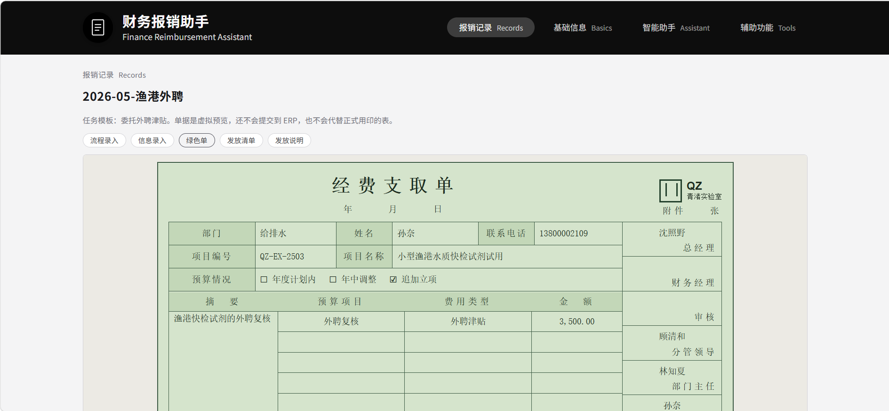
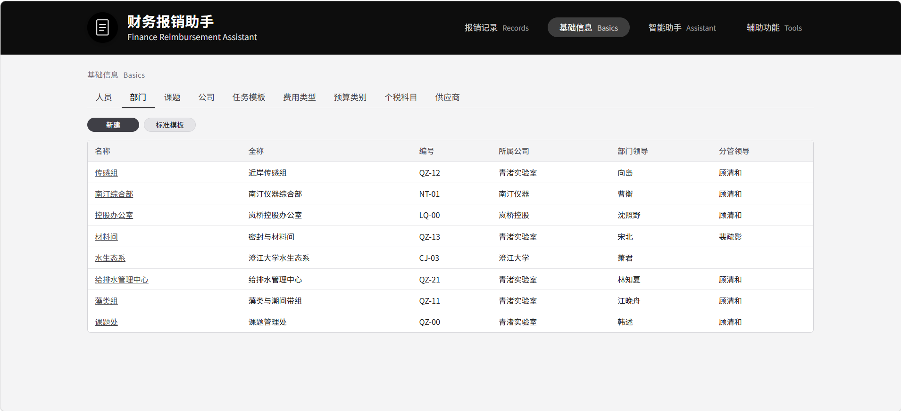

# AUTO FINANCE

财务报销助手

## 背景

广州市某企业的各类报销流程极其繁琐。具体来说，包括如下几点：
- 普通员工报销时，同一套信息要在表格、签字单和财务系统之间来回抄写。步骤多，容易错，也不容易看清办到了哪一步。
- 此前为了实现高效审批，公司引入了 ERP，但原纸质签字流程不取消。于是，员工们需要线上、线下各走一套流程。
- 不同流程需要签字和审批的领导数量不一；较为麻烦的，几乎要签遍所有领导。
- 不同领导签字的位置不同；每次调整分工，各个领导的签字位置也要变化。员工经常摸不着头脑，领导有时也会搞不清，自己面对不同的员工和报销单，分别要签哪几个位置。
- 不同填写项目之间有复杂的逻辑关系，但 ERP 不提供差错机制，一旦发现有错，就要从第一步重新开始。

本项目由这个问题触发，给普通员工一条更轻松的报销路径：把资料和规则收成档案，再按任务模板生成要填的单据。本项目中导出的单据，基本可以用于打印和正式提交。页面上的 ERP 只是按同一套档案排出来的样子，不会替提交到财务系统的流程（未来也许有机会接入GUI操作AGENT）。下图是"绿色单子"示例，由程序根据填写的少量资料，自动索引相关内容而生成。



## 准备

需要 Python 3.9 或更高版本，并安装：

```bat
pip install pyyaml openpyxl pymupdf lxml
```

## 启动

服务只监听本机 `http://127.0.0.1:8766`，因为...未接入用户系统，也无权限管理逻辑。否则就成了复刻已有ERP，成为已有ERP的改良版。

| 脚本 | 数据仓 |
| --- | --- |
| `start.sample.bat` | `data/repo.sample` |

也可以在命令行指定：

```bat
python -m backend repo.sample
```

等价写法是先设置 `AF_REPO`，再执行 `python -m backend`。

## 页面

- **报销记录**：按任务模板填写一条报销，记下流程进度，并打开对应单据。
- **基础信息**：维护人员、部门、公司、课题、任务模板、费用类型、预算类别、个税科目和供应商。
- **智能助手**：对话辅助，直接修改后台数据（听起来好刺激吖）。`未开发`
- **辅助功能**：上传 xlsx，按工作表导出横向 A4 的 PDF（超级实用...）。

基础信息把档案摊成表。下面是样例仓的部门。



一条记录能出现哪些单据，由它选用的任务模板决定。常见的有绿色单、ERP 预览、发放清单和发放说明。

## 数据仓

公开仓库只带 `data/repo.sample`。这是一套虚构资料，机构是青渚实验室及其关联单位，用来对外演示。

每个仓库根目录就是一套完整档案，没有额外的包装层。档案是带 frontmatter 的 Markdown。`[[名称]]` 指向另一份档案，文件名或档案里的 `id` 都可以。以 `_` 开头的文件是新建时用的空模板。

| 目录 | 内容 |
| --- | --- |
| `people` | 人员 |
| `departments` | 部门 |
| `companies` | 公司 |
| `grants` | 课题 |
| `fees` | 任务模板 |
| `feetypes` | 费用类型 |
| `budgets` | 预算类别 |
| `taxes` | 个税科目 |
| `vendors` | 供应商 |
| `records` | 报销记录 |
| `render` | 渲染规则 |

`render` 里，`角色.yaml` 把流程角色解析到人，`绿色单子.yaml` 全仓共用。任务模板上的 `A-录入`、`A-ERP`、`A-发放清单`、`A-发放说明` 填写对应渲染文件的名字；留空表示没有这一页。发放清单和发放说明可以指向同一份文件。

## 目录

```text
backend/            服务、档案读写、单据渲染
frontend/           页面
data/repo.sample/   虚构样例仓
data/repo.xxxxxx/   企业内部仓
start.sample.bat
```
